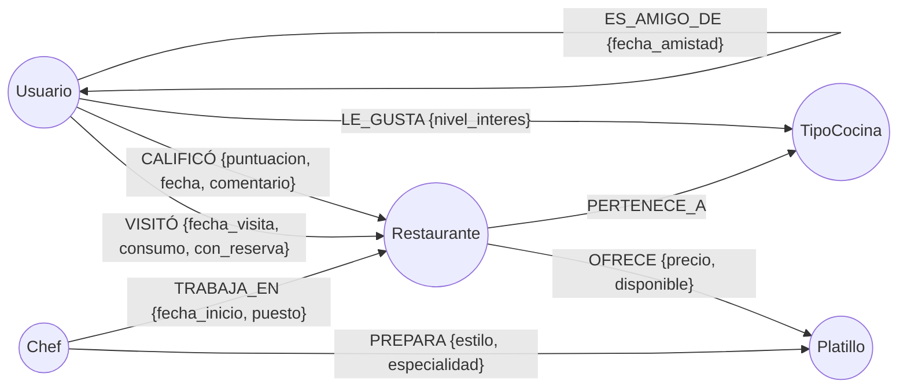

# Documentación Técnica – Sistema de Recomendación de Restaurantes con Neo4j
Sistemas de Bases de Datos 2 · USAC · Proyecto 2
# Henry Alexander García Montúfar 
## 201407049

## 1. Modelo conceptual de grafos

> Para entregar el diagrama como imagen (Mockups/Diseños) recréalo en **Arrows.app** o Draw.io con este mismo esquema y agrega 1–2 instancias reales (ej. `(:Usuario {id:'U0001'})-[:CALIFICÓ {puntuacion:5}]->(:Restaurante {id:'R010'})`). También puedes exportar la vista real con `CALL db.schema.visualization()` en Neo4j Browser.

## 2. Nodos y propiedades

| Etiqueta | Propiedades | Notas |
|---|---|---|
| `Usuario` | `id` (único), `nombre`, `email` (único), `edad` (int), `pais` | |
| `Restaurante` | `id` (único), `nombre`, `anio_apertura` (int), `rango_precios` (`$`,`$$`,`$$$`,`$$$$`), `descripcion` | |
| `TipoCocina` | `id` (único), `nombre`, `descripcion` | 15 tipos |
| `Chef` | `id` (único), `nombre`, `fecha_nacimiento` (date), `nacionalidad` | |
| `Platillo` | `id` (único), `nombre`, `precio` (float, precio base), `descripcion` | |

## 3. Relaciones y propiedades

| Relación | Patrón | Propiedades |
|---|---|---|
| `CALIFICÓ` | (Usuario)→(Restaurante) | `puntuacion` (1–5), `fecha` (date), `comentario` |
| `VISITÓ` | (Usuario)→(Restaurante) | `fecha_visita` (date), `consumo` (float), `con_reserva` (bool) |
| `ES_AMIGO_DE` | (Usuario)→(Usuario) | `fecha_amistad` (date) |
| `PERTENECE_A` | (Restaurante)→(TipoCocina) | — |
| `OFRECE` | (Restaurante)→(Platillo) | `precio`, `disponible` (bool) |
| `PREPARA` | (Chef)→(Platillo) | `estilo`, `especialidad` (bool) |
| `TRABAJA_EN` | (Chef)→(Restaurante) | `fecha_inicio` (date), `puesto` |
| `LE_GUSTA` | (Usuario)→(TipoCocina) | `nivel_interes` (1–5) |

## 4. Decisiones de diseño (justificación)

- **Propiedades en relaciones**: la calificación, la visita (consumo, reserva) y el precio por restaurante viven en la arista, porque pertenecen a *la interacción*, no a una sola entidad. Esto permite calcular promedios y tasas sin joins.
- **`ES_AMIGO_DE` en una dirección, consultada sin dirección**: una amistad es simétrica; guardarla una vez evita duplicados y se recorre con `(a)-[:ES_AMIGO_DE*1..3]-(b)`.
- **`VISITÓ` separado de `CALIFICÓ`**: se puede visitar sin calificar y visitar varias veces. La regla 6 excluye lo *visitado*, no solo lo calificado.
- **Reglas de negocio**: 
  - Regla 4 (1–5): se filtra en la carga y se valida en `05_validacion.cypher` (los constraints de rango son Enterprise).
  - Regla 5 (platillo no repetido): `MERGE (r)-[:OFRECE]->(p)` sobre el par; validado con V5.
  - Reglas 1–3: la cardinalidad muchos-a-muchos es natural en el grafo.
- **IDs de negocio únicos + constraints**: habilitan `MERGE` idempotente y búsquedas por índice.
- **Neo4j 5**: `USING PERIODIC COMMIT` (indicado en el enunciado) fue reemplazado por `CALL {…} IN TRANSACTIONS OF n ROWS`, que cumple el mismo objetivo (commits por lotes).

## 5. Datos de prueba

Generados con `datos/generar_datos.py` (semilla 42, reproducible):

| Entidad | Cantidad |
|---|---|
| Usuario | 500 |
| Restaurante | 200 |
| Chef | 100 |
| Platillo | 50 |
| TipoCocina | 15 |
| ES_AMIGO_DE | 2 100 (grafo conexo) |
| VISITÓ / CALIFICÓ | 6 772 / 3 544 |
| OFRECE / PREPARA / TRABAJA_EN / PERTENECE_A / LE_GUSTA | 1 470 / 456 / 207 / 336 / 1 506 |

Los datos incluyen sesgos intencionales (calidad por restaurante, probabilidad de reserva por rango de precio, outliers de consumo, gustos que sesgan las visitas) para que cada consulta tenga resultados.

## 6. Consultas implementadas (`consultas/`)

| # | Consulta | Técnica de grafo clave |
|---|---|---|
| Q1 | Recomendación social (≤3 grados, calif. ≥4, excluye visitados) | Camino de longitud variable `*1..3` no dirigido + agregación por restaurante |
| Q1b | Recomendación por chefs compartidos | Traversal de 4 saltos Usuario→Rest→Chef→Rest |
| Q2 | Chefs de alto impacto | Agregación en dos niveles (restaurante → chef) + `PREPARA`→`OFRECE` |
| Q3 | Restaurantes infravalorados | Comparación contra promedios globales |
| Q4 | Rango de precio vs consumo real | Agregación sobre propiedad de relación `VISITÓ.consumo` |
| Q5 | Cocina favorita vs real | `LE_GUSTA` vs `VISITÓ→PERTENECE_A` (2 saltos) |
| A1 | Grados de separación | `shortestPath` / `allShortestPaths` |
| A2 | Restaurantes altamente conectados | Patrón cíclico Restaurante–Platillo–Chef–Restaurante |

### Resultados

- **Q1**: un restaurante con `amigos_coincidentes` alto y `grado_mas_cercano` bajo es la recomendación más confiable (la opinión viene de personas cercanas).
- **Q2**: chefs con `platillos_difundidos` alto influyen en varios restaurantes, no solo en el propio.
- **Q3**: son restaurantes que la gente se esfuerza por reservar pero califica por debajo del promedio: posible sobre-demanda, servicio inconsistente o expectativas mal gestionadas.
- **Q4**: diferencias positivas grandes sugieren que el restaurante es más caro de lo declarado; negativas, que su categoría de precio está sobrestimada.
- **Q5**: usuarios cuyos hábitos no coinciden con lo declarado son candidatos a campañas de descubrimiento o a recalibrar su perfil.
- **A1**: en redes sociales densas el grado de separación típico es pequeño (3–5); úsalo para validar que el límite de 3 grados de Q1 cubre a la mayoría.
- **A2**: restaurantes con mayor puntaje concentran talento (chefs) y platillos de autor disponibles.

## 7. Ventajas de Neo4j para este problema

1. **Traversal sin JOINs**: Q1 recorre hasta 3 niveles de amistad con `*1..3`; en SQL requeriría 3 auto-joins o CTE recursivas, cada vez más costosos.
2. **Modelo natural**: el diagrama conceptual *es* el esquema físico.
3. **Rendimiento local**: el costo depende de la vecindad recorrida, no del tamaño total de las tablas (índice-free adjacency).
4. **Algoritmos de rutas nativos**: `shortestPath` y `allShortestPaths` en una línea.
5. **Propiedades en relaciones**: consumo, reserva y puntuación se agregan directamente sobre las aristas.
6. **Esquema flexible**: agregar nuevos tipos de relación (p. ej. `RECOMENDÓ`) no requiere migraciones.
7. **Extensible** a algoritmos de GDS (comunidades, PageRank) para el alcance opcional.
